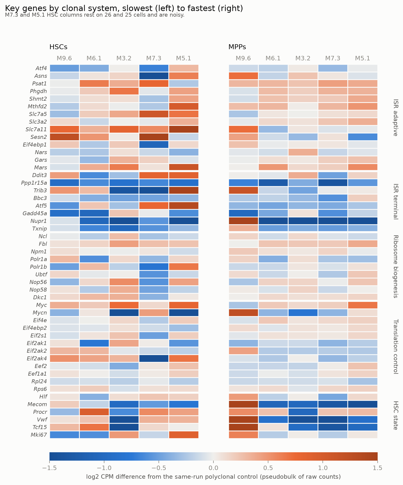
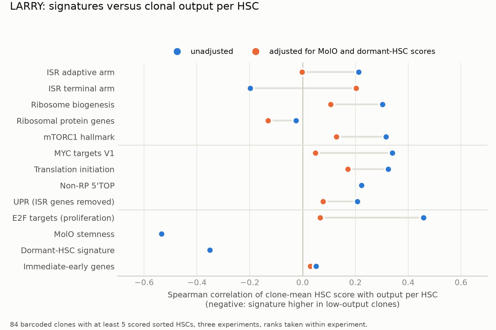

# ISR, translation programs and HSC reconstitution kinetics: exploratory report

Date 2026-11-16. Computational reanalysis of public mouse data; all readouts are transcript-level proxies. Plan and predictions were fixed in `docs/prespecification.md` before expression was inspected; data properties are in `docs/data-audit.md`.

## Summary

**The hypothesis.** H1: slow, high-self-renewal HSCs hold a restrained translational state with elevated ISR. H2: pushed further, that state trades blood output for self-renewal.

**What the data show.**

1. **Across the five clonal systems (Milsom), HSC translation-machinery signatures do not differ by kinetics.** Ribosome biogenesis, ribosomal protein genes and mTORC1 targets differ between slow and fast systems by less than 0.2 within-system SD, which is smaller than the difference between the two polyclonal controls (up to 0.46 SD).
2. **The adaptive ISR arm runs opposite to H1.** ATF4-target expression in HSCs is lowest in the slowest system and highest in the fastest (Spearman 0.9 with kinetic rank, exact p = 0.083; 1.0, p = 0.017 in the most primitive HSC subset). The size is modest (slow pair vs rest −0.39 SD) and it does not survive multiplicity (BH 0.42).
3. **The terminal ISR arm does not mark the slowest clone.** M9.6, the platelet-restricted clone that makes up 99% of the HSC pool, scores the same as its same-run polyclonal control (−0.10 SD).
4. **Across barcoded clones (LARRY), low-output HSC clones do carry a low-biosynthesis signature.** Low-output versus high-output clones: mTORC1 −0.96 SD, ribosome biogenesis −0.74 SD, adaptive ISR −0.62 SD (BH ≤ 0.01), terminal ISR +0.53 SD (BH 0.023). Ribosomal protein genes do not differ.
5. **That association is not separable from quiescence/stemness state.** After adjusting for two published stemness scores, every correlation with output per HSC falls to |ρ| ≤ 0.2 and none is distinguishable from zero.
6. **No evidence for an optimum.** Output per HSC is not highest in the middle tertile of any primary signature.

**Interpretation.** Low anabolic and ribosome-biogenesis transcription accompanies the low-output, stem-like clonal state, which fits the "restrained translation" half of H1. The ISR half is not supported at transcript level: ATF4-target genes move with biosynthetic programs, not against them, and a quarter of them are also mTORC1 targets. Whether slow HSCs have higher eIF2α phosphorylation or ATF4 translation cannot be read from these data in either direction. H2 is untested: one extreme clone that does not show a restraint signature beyond its control, and no curve shape in LARRY.

**Confidence.** Moderate that low-output clones have lower biosynthesis transcripts (84 clones, three experiments, stable across clone-size thresholds). Low for everything about kinetics (five mice, two runs, one mouse per clone). No confidence in any causal or protein-level statement.

## Figure 1. Primary signatures across the five clonal systems


Intervals reflect cell sampling only; the unit of inference is the mouse. The two controls differ from each other by as much as the clonal systems differ among themselves for most signatures.

## Figure 2. Key genes in HSCs and MPPs



Pseudobulk of raw counts, each system shown relative to its same-run control. No block of ISR, ribosome-biogenesis or translation-control genes orders with kinetics. *Atf4* mRNA itself shows no ordering with kinetics. *Vwf*, *Tcf15*, *Nupr1* and *Mecom* are raised in M9.6 MPPs, consistent with its stem-like compartment.

## Figure 3. LARRY clones: signatures versus output per HSC



## Results table

Effect sizes: Milsom, slowest two systems minus the other three in pooled within-system SD units of the HSC score; LARRY, low-output minus high-output clones in within-experiment SD units. ρ: Spearman.

| Signature | Milsom: ρ with fast rank (exact p) | Milsom: slow − rest | Within-run pairs, slower higher | LARRY: low − high output (BH) | LARRY: ρ with output per HSC, unadjusted → stemness-adjusted | Read-out |
|---|---|---|---|---|---|---|
| ISR adaptive | +0.9 (0.083) | −0.39 | 0 of 4 | −0.62 (0.010) | +0.21 → 0.00 | Lower in slow and in low-output HSCs; opposite to H1; follows stemness/biosynthesis |
| ISR terminal | −0.1 (0.95) | +0.42 | 1 of 4 | +0.53 (0.023) | −0.20 → +0.20 | Inconsistent; sign flips on adjustment; shares genes with quiescence sets |
| Ribosome biogenesis | +0.3 (0.68) | −0.08 | 1 of 4 | −0.74 (0.002) | +0.30 → +0.11 | No kinetic signal; lower in low-output clones, explained by stemness |
| Ribosomal protein genes | +0.2 (0.78) | +0.14 | 2 of 4 | −0.30 (0.18) | −0.02 → −0.13 | No association in either dataset |
| mTORC1 hallmark | +0.3 (0.68) | −0.14 | 1 of 4 | −0.96 (<0.001) | +0.32 → +0.13 | No kinetic signal; lower in low-output clones, explained by stemness |

Sample sizes: Milsom 5 clonal mice and 2 control mice; 825, 147, 243, 26 and 25 annotated HSCs in kinetic order. LARRY 84 clones with at least 5 scored sorted HSCs (51 low-output, 30 high-output, 3 unlabelled) ; results hold at thresholds of 3 (107 clones) and 10 (52 clones). Multiple testing: BH over the five primary signatures; secondary sets are in `results/` and are uncorrected.

Confounding checks:

- **Run.** Between the two Milsom controls, immediate-early genes differ by 1.07 SD and the low-output stemness score by 1.08 SD. Any M9.6 feature shared with control M16 (for example high *Vwf*, *Tcf15*, *Txnip*, *Nupr1*) cannot be assigned to the clone.
- **Stemness and cycling.** Restricting to the top stemness tertile or to G1 cells does not change the Milsom picture. In LARRY, proliferation (E2F ρ = +0.46) and stemness (MolO ρ = −0.53) scores track output more strongly than any translation signature.
- **Depth and handling.** Scores are rank-based within cell. Immediate-early genes show no association with output in LARRY.

## What these data can and cannot resolve

**Resolved, at transcript level**

- Low-output HSC clones have lower mTORC1-target, ribosome-biogenesis and MYC-target expression than high-output clones.
- Ribosomal protein mRNA abundance carries no information on kinetics or output here.
- Adaptive ISR target expression is not elevated in slow or low-output HSCs; if anything it is lower.

**Not resolved, and why**

- **Whether slow kinetics is linked to translational restraint.** Five mice in two runs, with kinetics, HSC share and lineage restriction collinear. A real effect of the size seen in LARRY (0.6–1 SD between clone classes) would not be reliably detectable; equally, the absence of a trend is not evidence of absence.
- **Whether ISR signalling is higher in slow HSCs.** ISR activation is a translational event; its transcriptional targets are co-driven by mTORC1 and MYC, so target mRNA reports anabolic state as much as eIF2α phosphorylation.
- **Whether the association is independent of quiescence.** In LARRY it is not separable; the data cannot say which is upstream.
- **H2, the "too far" state.** One candidate clone (M9.6), within 0.3 SD of its same-run control on four of five primary signatures and 0.73 SD higher on ribosomal protein genes, which is the opposite of restraint; and no non-monotone pattern across 84 LARRY clones. Healthy transplant data do not contain a state beyond the normal range.
- **Kinetics in LARRY.** Not measured; output per HSC at one time point is a different quantity.
- **Clone origin of Milsom HSCs** cannot be confirmed from the deposited object.

**Not done**

- `scBM_atlas.rds` and `slingshot.rds` were not loaded; HSC-to-MPP trajectory analysis was limited to comparing annotated HSCs and MPPs.
- The optional H2 contrast dataset (aged or *Tet2*/*Dnmt3a*-mutant HSCs) was not pursued.
- Citations attached to the curated gene lists, and the paper's correction notice, are unchecked.
- The second LARRY dataset the paper reanalyses (GSE299000) was not examined.

## Most informative next experiments (design level)

1. **Measure protein synthesis and ISR directly in kinetically defined HSCs.** O-propargyl-puromycin incorporation together with an ATF4 translational reporter or phospho-eIF2α, in HSCs from slow and fast clonal systems, gated on the same phenotypic HSC fraction and cell-cycle phase. This answers the question the transcriptome cannot.
2. **Graded ISR perturbation with output per HSC as the readout.** Several levels of ISR inhibition and activation in transplanted HSCs, scoring reconstitution kinetics, HSC retention and blood output per HSC. A peaked response would support H2; a monotone one would not.
3. **Daughter-cell design.** The source study shows that slow clones give rise to faster daughters on serial transplantation. Comparing protein synthesis rate and ISR reporter activity between a parent clone and its faster daughters holds genetic background and niche history constant and removes the between-mouse confounding that limits this analysis.

A wild-type versus *Tet2*-deficient comparison is useful only with replicate animals per genotype and the direct measurements in point 1; transcript scores alone would repeat the ambiguity found here.

## Reproducing

```
scripts/download_zenodo_19486868.sh all        # then unzip under data/raw/zenodo_19486868/extracted
python3 scripts/build_gene_sets.py
Rscript scripts/milsom_score_hspc.R
.venv/bin/python scripts/milsom_stats.py
.venv/bin/python scripts/larry_clone_scores.py && .venv/bin/python scripts/larry_stats.py
.venv/bin/python scripts/make_figures.py
```

MSigDB, the LARRY repository and the LARRY matrices were fetched by hand from the URLs in `metadata/datasets.tsv`; no download script exists for them yet.

## Round 2 (exploratory, HSC-only; Amendment 2 of the prespecification)

Run after the results above had been seen, so nothing here is confirmatory. Headline values are unadjusted for stemness, because stemness and growth state may be consequences of ISR-regulated translation and not confounders. All scores are transcript proxies. Tables are in `results/round2/`; scripts are `scripts/build_gene_sets_round2.py`, `scripts/milsom_round2_score.R`, `scripts/milsom_round2_stats.py`, `scripts/larry_round2.py`.

Three read-outs replace the single adaptive ISR score: `ISR_stress_specific` (11 genes tied to the eIF2α-P route; membership from memory, unverified), `ATF4_biosynth` (route-ambiguous ATF4 biosynthetic targets) and `Growth_noATF4` (hallmark mTORC1 without any ISR gene).

### Milsom: HSCs compared between clones (cell-level SD units, slower minus faster; intervals are over cells, each clone is one unit)

| Read-out | M9.6 − M3.2 (run 2) | M6.1 − M7.3 (run 1) | M6.1 − M5.1 (run 1) | M9.6 − control | M3.2 − control |
|---|---|---|---|---|---|
| ISR_stress_specific | +0.84 [+0.70, +0.98] | −0.10 [−0.49, +0.26] | +0.02 [−0.41, +0.43] | −0.10 | −0.91 |
| ATF4_biosynth | −0.31 [−0.46, −0.16] | −0.17 [−0.64, +0.28] | −0.48 [−1.08, +0.05] | −0.02 | +0.28 |
| Growth_noATF4 | −0.17 [−0.30, −0.04] | +0.25 [−0.16, +0.68] | −0.55 [−0.95, −0.19] | +0.17 | +0.37 |
| RiBi_nonRP | −0.31 [−0.44, −0.17] | +0.41 [+0.03, +0.79] | −0.19 [−0.63, +0.22] | +0.31 | +0.68 |
| Stem_MolO | +1.21 [+1.10, +1.35] | +0.59 [+0.19, +1.03] | −0.25 [−0.74, +0.19] | +0.40 | −0.85 |
| log10 UMIs per cell | +1.29 [+1.12, +1.45] | +0.09 [−0.26, +0.54] | −1.10 [−1.43, −0.82] | +0.89 | −0.49 |

- The slowest clone against the mid-kinetics clone sequenced with it shows the pattern the restraint reading predicts (stress-specific genes higher, growth read-outs lower). The stress difference arises because M3.2 sits far below the shared control while M9.6 equals it; M9.6 is above the control on both growth read-outs.
- The run-1 pairs do not reproduce it. The two fastest clones have 26 and 25 HSCs.
- Genome-wide, the two independent slower-versus-faster contrasts (M9.6 vs M3.2; M6.1 vs M7.3+M5.1; 6,581 genes) do not agree: Spearman −0.03. A small group of known stem-cell genes is higher in the slower clone in both (Tcf15, Mecom, Mpl, Ly6a, Hoxa10, Nupr1) and proliferation or priming genes are lower (Mki67, Flt3, Cd48, Sell).
- Slow-clone HSCs do not carry fewer transcripts; M9.6 has more UMIs per HSC than M3.2 and than the control.

### LARRY: low- versus high-output clones (51 vs 30 clones; within-experiment SD units; permutation p)

| Read-out | Low − high output | p | ρ with output per HSC | ρ after stemness adjustment |
|---|---|---|---|---|
| ISR_stress_specific | +0.19 | 0.42 | −0.11 | +0.02 |
| ISR_terminal (round 1 set) | +0.53 | 0.019 | −0.20 | +0.20 |
| ATF4_biosynth | −0.72 | 0.001 | +0.27 | +0.04 |
| Growth_noATF4 | −0.95 | <0.001 | +0.31 | +0.11 |
| RiBi_nonRP | −0.74 | 0.001 | +0.30 | +0.11 |
| RP_cytoplasmic | −0.30 | 0.18 | −0.03 | −0.13 |

- Unadjusted, HSCs of low-output clones express less of the growth and ribosome-biogenesis programmes. ATF4 biosynthetic targets fall with them (clone-level correlation with growth read-outs 0.59 to 0.64), which is the growth-route pattern. The stress-specific set is flat and uncorrelated with growth (−0.04).
- HSC-rich, low-output clones (21 of 84): no read-out differs from the other clones (stress-specific +0.20, p = 0.43).
- Genome-wide ranking of 14,253 genes: stemness genes lead the low-output side (Ifitm1, Nupr1, Mllt3, Procr, Ly6a, Mecom) and cell-cycle and MYC-target genes lead the high-output side (mean percentile rank 0.23 to 0.25). Translation, ribosome-biogenesis and mTORC1 sets sit modestly below the middle (0.34 to 0.44). The `Stem_LowOutput` set was derived from this dataset, so its top rank is circular.
- Nupr1, a stress-inducible ATF4-target gene, is the second-ranked gene in low-output clones and is higher in the slower clone in both Milsom contrasts. This is one gene and a lead only.

### Across datasets

Spearman correlation of the LARRY low-minus-high-output gene differences with Milsom HSC contrasts (6,246 genes): M9.6 vs M3.2 +0.30; M9.6 vs control +0.12; M3.2 vs control −0.27; M6.1 vs M7.3+M5.1 −0.03; M6.1 vs control −0.03. M9.6 HSCs resemble low-output HSCs and M3.2 HSCs resemble high-output HSCs; the run-1 clones show no relation.

### Reading

- Supported as association: HSCs of low-output clones, and of the slowest clone relative to its run-mate, sit lower on growth and ribosome-biogenesis transcripts. This is the same axis as the stemness scores, so it does not distinguish the hypothesis from the known low-biosynthesis state of dormant HSCs.
- Not supported: that the ISR is the restraining signal. ISR-route-specific transcripts are not higher in low-output clones, and the ATF4 targets that do change move with growth. The gene set is small and unverified, and eIF2α phosphorylation need not leave a strong transcript trace, so this is absence of evidence at transcript level.
- H2: no sign that HSC-rich, low-output clones carry a stronger stress signature.
- Kinetics in general remains unresolved: one within-run clone pair shows the pattern, the others do not.

## Round 3 (exploratory, HSC-only; Amendment 3): published ISR-route and biosynthesis sets

Same contrasts and statistics as round 2, unadjusted for stemness, transcript proxies throughout. Tables in `results/round3/`; scripts `scripts/build_gene_sets_round3.py`, `scripts/milsom_round3_score.R`, `scripts/round3_stats.py`.

**Correction to round 2.** The source data of Torrence et al. 2021 (eLife 10:e63326; mouse embryonic fibroblasts) list Ddit3, Chac1, Ddit4, Sesn2 and Atf5 among 61 ATF4 targets induced by both the stress route and mTORC1. Five of the eleven genes in the hand-picked round-2 `ISR_stress_specific` set were therefore not route-specific. The sets below replace it: `T21_ATF4_shared` (61 genes), `T21_ATF4_stress_only` (171 ATF4-dependent tunicamycin-induced genes not induced by insulin; one ISR branch, one cell type) and `T21_mTORC1_nonATF4` (176 rapamycin-sensitive genes that do not depend on ATF4).

### LARRY: low- versus high-output clones (51 vs 30; within-experiment SD units; BH over the 21 sets of this round)

| Set | Low − high output | p | BH |
|---|---|---|---|
| ATF4 targets, stress route only | +0.09 | 0.69 | 0.76 |
| ATF4 targets, shared with mTORC1 | −0.58 | 0.010 | 0.021 |
| mTORC1 targets not needing ATF4 | −1.06 | <0.001 | <0.001 |
| Reactome PERK / ATF4-ER-stress / GCN2 / HRI | −0.52 / −0.39 / −0.13 / +0.02 | 0.020 / 0.088 / 0.59 / 0.92 | |
| Pyrimidine / purine synthesis | −1.00 / −0.77 | <0.001 / 0.001 | |
| One-carbon / serine synthesis | −0.93 / −0.70 | <0.001 / 0.001 | |
| Mitochondrial translation / OXPHOS / glycolysis | −0.96 / −0.89 / −0.85 | all <0.001 | |
| Cytoplasmic translation factors (non-RP) | −0.84 | <0.001 | <0.001 |
| Pol I transcription / SSU / LSU biogenesis | −0.58 / −0.54 / −0.48 | 0.011 / 0.017 / 0.034 | |
| Cholesterol / fatty-acid synthesis | −0.04 / −0.28 | 0.86 / 0.22 | |

- The stress-route-only ATF4 targets do not differ; the shared ATF4 targets fall with the ATF4-independent mTORC1 targets (clone-level correlation 0.52; stress-only versus mTORC1 0.01). This is the growth-route pattern fixed in advance.
- The lower expression in low-output HSCs is not confined to protein synthesis. Nucleotide synthesis, one-carbon metabolism, mitochondrial translation and energy metabolism differ as much as or more than ribosome biogenesis; lipid synthesis does not differ.
- HSC-rich, low-output clones (21 of 84) are lower on pyrimidine synthesis (−0.77, p = 0.002) and nominally on one-carbon and purine synthesis; no ISR set differs (stress-only −0.02).
- With stemness adjustment every association with output per HSC is near zero (largest: stress-only +0.21, glycolysis +0.18).

### Milsom: HSCs between clones (cell-level SD units)

| Set | M9.6 − M3.2 | M6.1 − M7.3 | M6.1 − M5.1 | M9.6 − control | M5.1 − control |
|---|---|---|---|---|---|
| ATF4 targets, stress route only | +0.27 | +0.09 | −0.66 | +0.04 | +0.64 |
| ATF4 targets, shared | +0.13 | +0.21 | −0.34 | +0.32 | +0.50 |
| mTORC1 targets not needing ATF4 | −0.58 | +0.13 | −0.48 | −0.21 | +1.11 |
| Cytoplasmic translation factors | +0.43 | +0.25 | −0.93 | +0.56 | +1.28 |
| Purine synthesis | +0.30 | +0.06 | −0.38 | +0.62 | +1.45 |
| OXPHOS | +0.08 | +0.02 | −0.37 | +0.34 | +1.48 |

- The slowest clone is lower than its run-mate and its control on ATF4-independent mTORC1 targets, with a small rise in stress-only ATF4 targets against the run-mate (+0.27) and none against the control (+0.04). Other biosynthesis sets do not move consistently in that pair.
- The fastest clone (M5.1, 25 HSCs) is higher than its control and its slower run-mates on almost every set, stress-only ATF4 targets included.

### Reading

Using published sets strengthens the round-2 reading. Low-output and slow-clone HSCs show a broadly quieter growth and metabolic transcript state, of which translation machinery is one part; there is no transcript-level sign that the stress route to ATF4 is more active in them. Limits specific to this round: the route split comes from fibroblasts under one stressor, many stress-only genes are not expressed in HSCs, and eIF2α phosphorylation itself is not measured.
