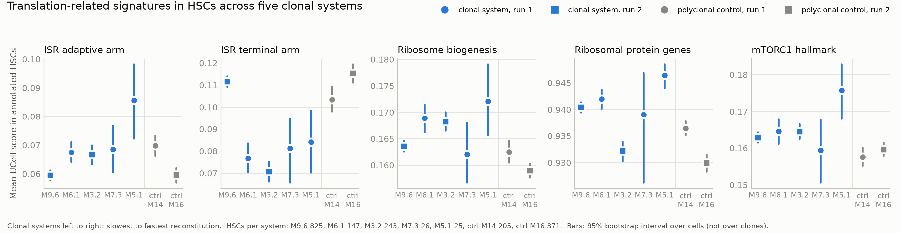

# ISR, translation programs and HSC reconstitution kinetics: exploratory report

Date 2026-11-16. Computational reanalysis of public mouse data; all readouts are transcript-level proxies. Plan and predictions were fixed in `docs/prespecification.md` before expression was inspected; data properties are in `docs/data-audit.md`.

## Summary

**The hypothesis.** H1: slow, high-self-renewal HSCs hold a restrained translational state with elevated ISR. H2: pushed further, that state trades blood output for self-renewal.

**What the data show.**

1. **Across the five clonal systems (Milsom), HSC translation-machinery signatures do not differ by kinetics.** Ribosome biogenesis, ribosomal protein genes and mTORC1 targets differ between slow and fast systems by less than 0.2 within-system SD, which is smaller than the difference between the two polyclonal controls (up to 0.46 SD).
2. **The adaptive ISR arm runs opposite to H1.** ATF4-target expression in HSCs is lowest in the slowest system and highest in the fastest (Spearman 0.9 with kinetic rank, exact p = 0.083; 1.0, p = 0.017 in the most primitive HSC subset). The size is modest (slow pair vs rest −0.39 SD) and it does not survive multiplicity (BH 0.42).
3. **The terminal ISR arm does not mark the slowest clone.** M9.6, the platelet-restricted clone that makes up 99% of the HSC pool, scores the same as its same-run polyclonal control (−0.10 SD).
4. **Across barcoded clones (LARRY), low-output HSC clones do carry a low-biosynthesis signature.** Low-output versus high-output clones: mTORC1 −0.96 SD, ribosome biogenesis −0.74 SD, adaptive ISR −0.62 SD (BH ≤ 0.01), terminal ISR +0.53 SD (BH 0.023). Ribosomal protein genes do not differ.
5. **That association is not separable from quiescence/stemness state.** After adjusting for two published stemness scores, every correlation with output per HSC falls to |ρ| ≤ 0.2 and none is distinguishable from zero.
6. **No evidence for an optimum.** Output per HSC is not highest in the middle tertile of any primary signature.

**Interpretation.** Low anabolic and ribosome-biogenesis transcription accompanies the low-output, stem-like clonal state, which fits the "restrained translation" half of H1. The ISR half is not supported at transcript level: ATF4-target genes move with biosynthetic programs, not against them, and a quarter of them are also mTORC1 targets. Whether slow HSCs have higher eIF2α phosphorylation or ATF4 translation cannot be read from these data in either direction. H2 is untested: one extreme clone that does not show a restraint signature beyond its control, and no curve shape in LARRY.

**Confidence.** Moderate that low-output clones have lower biosynthesis transcripts (84 clones, three experiments, stable across clone-size thresholds). Low for everything about kinetics (five mice, two runs, one mouse per clone). No confidence in any causal or protein-level statement.

## Figure 1. Primary signatures across the five clonal systems



Intervals reflect cell sampling only; the unit of inference is the mouse. The two controls differ from each other by as much as the clonal systems differ among themselves for most signatures.

## Figure 2. Key genes in HSCs and MPPs


Pseudobulk of raw counts, each system shown relative to its same-run control. No block of ISR, ribosome-biogenesis or translation-control genes orders with kinetics. *Atf4* mRNA itself shows no ordering with kinetics. *Vwf*, *Tcf15*, *Nupr1* and *Mecom* are raised in M9.6 MPPs, consistent with its stem-like compartment.

## Figure 3. LARRY clones: signatures versus output per HSC


## Results table

Effect sizes: Milsom, slowest two systems minus the other three in pooled within-system SD units of the HSC score; LARRY, low-output minus high-output clones in within-experiment SD units. ρ: Spearman.

| Signature | Milsom: ρ with fast rank (exact p) | Milsom: slow − rest | Within-run pairs, slower higher | LARRY: low − high output (BH) | LARRY: ρ with output per HSC, unadjusted → stemness-adjusted | Read-out |
|---|---|---|---|---|---|---|
| ISR adaptive | +0.9 (0.083) | −0.39 | 0 of 4 | −0.62 (0.010) | +0.21 → 0.00 | Lower in slow and in low-output HSCs; opposite to H1; follows stemness/biosynthesis |
| ISR terminal | −0.1 (0.95) | +0.42 | 1 of 4 | +0.53 (0.023) | −0.20 → +0.20 | Inconsistent; sign flips on adjustment; shares genes with quiescence sets |
| Ribosome biogenesis | +0.3 (0.68) | −0.08 | 1 of 4 | −0.74 (0.002) | +0.30 → +0.11 | No kinetic signal; lower in low-output clones, explained by stemness |
| Ribosomal protein genes | +0.2 (0.78) | +0.14 | 2 of 4 | −0.30 (0.18) | −0.02 → −0.13 | No association in either dataset |
| mTORC1 hallmark | +0.3 (0.68) | −0.14 | 1 of 4 | −0.96 (<0.001) | +0.32 → +0.13 | No kinetic signal; lower in low-output clones, explained by stemness |

Sample sizes: Milsom 5 clonal mice and 2 control mice; 825, 147, 243, 26 and 25 annotated HSCs in kinetic order. LARRY 84 clones with at least 5 scored sorted HSCs (51 low-output, 30 high-output, 3 unlabelled) ; results hold at thresholds of 3 (107 clones) and 10 (52 clones). Multiple testing: BH over the five primary signatures; secondary sets are in `results/` and are uncorrected.

Confounding checks:

- **Run.** Between the two Milsom controls, immediate-early genes differ by 1.07 SD and the low-output stemness score by 1.08 SD. Any M9.6 feature shared with control M16 (for example high *Vwf*, *Tcf15*, *Txnip*, *Nupr1*) cannot be assigned to the clone.
- **Stemness and cycling.** Restricting to the top stemness tertile or to G1 cells does not change the Milsom picture. In LARRY, proliferation (E2F ρ = +0.46) and stemness (MolO ρ = −0.53) scores track output more strongly than any translation signature.
- **Depth and handling.** Scores are rank-based within cell. Immediate-early genes show no association with output in LARRY.

## What these data can and cannot resolve

**Resolved, at transcript level**

- Low-output HSC clones have lower mTORC1-target, ribosome-biogenesis and MYC-target expression than high-output clones.
- Ribosomal protein mRNA abundance carries no information on kinetics or output here.
- Adaptive ISR target expression is not elevated in slow or low-output HSCs; if anything it is lower.

**Not resolved, and why**

- **Whether slow kinetics is linked to translational restraint.** Five mice in two runs, with kinetics, HSC share and lineage restriction collinear. A real effect of the size seen in LARRY (0.6–1 SD between clone classes) would not be reliably detectable; equally, the absence of a trend is not evidence of absence.
- **Whether ISR signalling is higher in slow HSCs.** ISR activation is a translational event; its transcriptional targets are co-driven by mTORC1 and MYC, so target mRNA reports anabolic state as much as eIF2α phosphorylation.
- **Whether the association is independent of quiescence.** In LARRY it is not separable; the data cannot say which is upstream.
- **H2, the "too far" state.** One candidate clone (M9.6), within 0.3 SD of its same-run control on four of five primary signatures and 0.73 SD higher on ribosomal protein genes, which is the opposite of restraint; and no non-monotone pattern across 84 LARRY clones. Healthy transplant data do not contain a state beyond the normal range.
- **Kinetics in LARRY.** Not measured; output per HSC at one time point is a different quantity.
- **Clone origin of Milsom HSCs** cannot be confirmed from the deposited object.

**Not done**

- `scBM_atlas.rds` and `slingshot.rds` were not loaded; HSC-to-MPP trajectory analysis was limited to comparing annotated HSCs and MPPs.
- The optional H2 contrast dataset (aged or *Tet2*/*Dnmt3a*-mutant HSCs) was not pursued.
- Citations attached to the curated gene lists, and the paper's correction notice, are unchecked.
- The second LARRY dataset the paper reanalyses (GSE299000) was not examined.

## Most informative next experiments (design level)

1. **Measure protein synthesis and ISR directly in kinetically defined HSCs.** O-propargyl-puromycin incorporation together with an ATF4 translational reporter or phospho-eIF2α, in HSCs from slow and fast clonal systems, gated on the same phenotypic HSC fraction and cell-cycle phase. This answers the question the transcriptome cannot.
2. **Graded ISR perturbation with output per HSC as the readout.** Several levels of ISR inhibition and activation in transplanted HSCs, scoring reconstitution kinetics, HSC retention and blood output per HSC. A peaked response would support H2; a monotone one would not.
3. **Daughter-cell design.** The source study shows that slow clones give rise to faster daughters on serial transplantation. Comparing protein synthesis rate and ISR reporter activity between a parent clone and its faster daughters holds genetic background and niche history constant and removes the between-mouse confounding that limits this analysis.

A wild-type versus *Tet2*-deficient comparison is useful only with replicate animals per genotype and the direct measurements in point 1; transcript scores alone would repeat the ambiguity found here.

## Reproducing

```
scripts/download_zenodo_19486868.sh all        # then unzip under data/raw/zenodo_19486868/extracted
python3 scripts/build_gene_sets.py
Rscript scripts/milsom_score_hspc.R
.venv/bin/python scripts/milsom_stats.py
.venv/bin/python scripts/larry_clone_scores.py && .venv/bin/python scripts/larry_stats.py
.venv/bin/python scripts/make_figures.py
```

MSigDB, the LARRY repository and the LARRY matrices were fetched by hand from the URLs in `metadata/datasets.tsv`; no download script exists for them yet.
